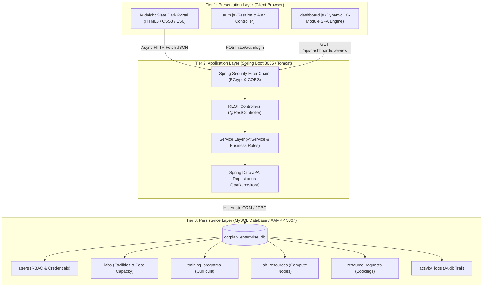

# CorpLab Nexus | Master Architecture & Project Presentation Guide
## Corporate Training Resource & Lab Infrastructure Management System

**Target Audience:** Project Managers, Faculty Evaluators, Technical Guides, BCA Reviewers  
**Platform Architecture:** Enterprise 3-Tier Architecture (MySQL &rarr; Spring Boot 3 REST APIs &rarr; Modern Asynchronous SPA)  
**Primary Tech Stack:** Java 17/21, Spring Boot 3.2.5, Spring Data JPA, Spring Security, MySQL 8.0 / XAMPP, Postman v2.1, HTML5, CSS3 (Midnight Slate Dark Theme), Vanilla ES6+ JavaScript  

---

## 1. Executive Summary & Problem Statement

### The Problem in Enterprise Organizations:
In modern technology corporations, employee upskilling and continuous technical training (in Cloud, DevOps, AI, and Cybersecurity) is vital. However, organizations face two costly operational bottlenecks:
1. **Curriculum & Trainer Disconnection:** Training courses, materials, and certified trainers are managed in disparate spreadsheets and emails.
2. **Hardware Infrastructure Conflicts:** High-performance lab environments (GPU deep learning rigs, Kubernetes master nodes, high-availability database servers) are expensive and limited. Trainees and teams frequently face scheduling overlaps and unauthorized hardware claims.

### The Solution — CorpLab Nexus:
**CorpLab Nexus** is a unified, centralized, role-based corporate platform that manages the entire lifecycle of corporate training:
* **Curriculum Management:** Tracks certified trainers, scheduled course cohorts, and learning members.
* **Infrastructure Allocation:** Manages physical and virtual laboratory venues, compute node capacities, and reservation queues with strict administrative approval workflows.
* **Audit & Telemetry:** Provides real-time capacity telemetry, institutional completion analytics, and chronological security audit logging.

---

## 2. Enterprise 3-Tier Architecture

The platform is designed following industry-standard **3-Tier Separation of Concerns**:



---

## 3. Database Layer (MySQL & XAMPP phpMyAdmin)

### Database Configuration:
* **Host & Port:** `127.0.0.1:3307` (XAMPP MySQL port)
* **Database Name:** `corplab_enterprise_db`
* **Administrative User:** `root` (Default empty password)
* **ORM Framework:** Hibernate 6.4 (via Spring Data JPA) with `ddl-auto=update`

### Core Relational Entities:
1. **`users`:** Stores system administrators, certified trainers, and corporate trainees. Sensitive passwords are encrypted using one-way cryptographic **BCrypt hashing** (`$2a$10$...`).
2. **`labs`:** Catalogs physical and virtual laboratory rooms, seating capacities, and operational statuses (`ACTIVE`, `MAINTENANCE`).
3. **`training_programs`:** Manages course syllabus tracks, assigned instructors, cohort dates, and enrollment metrics.
4. **`lab_resources`:** Tracks dedicated high-performance hardware assets (e.g., *NVIDIA RTX 4090 Deep Learning Rig*, *Kubernetes Master Node*) with RAM/vCPU metrics and reservation flags (`AVAILABLE`, `RESERVED`).
5. **`resource_requests`:** Handles the hardware allocation queue with full lifecycle statuses (`PENDING` &rarr; `APPROVED` / `REJECTED`).
6. **`activity_logs`:** Append-only chronological audit log capturing user actions, timestamps, and operator IDs for compliance.

---

## 4. Backend Application Layer (Spring Boot 3 + Java 17)

The backend is built with **Spring Boot 3.2.5** running an embedded **Apache Tomcat** web server on port **`8085`**.

### Layered Code Organization:
```text
backend/src/main/java/com/corplab/platform/
├── config/
│   ├── SecurityConfig.java       # CORS rules, CSRF protection, BCrypt PasswordEncoder
│   └── WebMvcConfig.java         # Root static resource routing and SPA view controllers
├── controller/
│   ├── AuthController.java       # /api/auth (Login, Logout, Profile, Registration)
│   ├── DashboardController.java  # /api/dashboard (Overview KPIs, Chart Telemetry)
│   ├── EmployeeController.java   # /api/employees (Full CRUD for Learning Members)
│   ├── TrainerController.java    # /api/trainers (Faculty Roster & Specializations)
│   ├── TrainingProgramController.java # /api/training-programs (Curriculum Tracks)
│   ├── LabController.java        # /api/labs (Facility Infrastructure)
│   ├── ResourceController.java   # /api/resources (Compute Nodes & Hardware)
│   ├── ResourceRequestController.java # /api/resource-requests (Booking Workflow)
│   ├── ReportController.java     # /api/reports (Analytics Aggregations)
│   ├── SettingsController.java   # /api/settings (Audit Logs & RBAC Profile)
│   └── RootController.java       # / (Auto-redirect to /login.html)
├── entity/                       # JPA Entities with Jakarta Persistence annotations
├── repository/                   # Spring Data JPA interfaces with derived query methods
├── service/                      # Business logic, validation, and session auth guards
└── PlatformApplication.java      # Application entrypoint & CommandLineRunner database seeder
```

---

## 5. API Testing & Verification Layer (Postman)

### Why Postman Was Used:
In professional enterprise engineering, developers verify REST endpoints in **Postman** before connecting frontend user interfaces. This guarantees:
1. **Decoupled Verification:** Proves the backend application logic and database queries function independently of browser rendering.
2. **HTTP Protocol Compliance:** Validates correct request methods (`GET`, `POST`, `PUT`, `DELETE`), HTTP status codes, and JSON serialization.
3. **Session Cookie Security:** Postman automatically stores and transmits the `JSESSIONID` session cookie across authenticated requests.

### Key API Verification Points:
| Module | Endpoint | Method | Expected Status | Purpose |
| :--- | :--- | :--- | :--- | :--- |
| **Auth** | `/api/auth/login` | `POST` | `200 OK` | Validates credentials; issues session cookie |
| **Dashboard** | `/api/dashboard/overview` | `GET` | `200 OK` | Returns aggregated metrics from MySQL |
| **Employees** | `/api/employees` | `POST` | `201 Created` | Inserts new learning member into MySQL |
| **Employees** | `/api/employees` | `GET` | `200 OK` | Returns employee directory list |
| **Requests** | `/api/resource-requests/{id}/status` | `PUT` | `200 OK` | Approves or rejects lab booking |
| **Audit Logs**| `/api/settings/logs` | `GET` | `200 OK` | Returns chronological security audit trail |

---

## 6. Frontend Presentation Tier (UI/UX & Design Philosophy)

### Midnight Slate Enterprise Design System:
The user interface was crafted with a modern, high-contrast dark theme inspired by enterprise consoles like AWS Management Console, Datadog, and GitHub:
* **Background Canvas:** Deep Midnight Slate (`#070d1e` / `#0e172e`) providing eye comfort during prolonged administrative shifts.
* **Surface Cards:** Elevated Midnight Navy (`#14213d`) with subtle border delineations (`#24355a`).
* **Accent Palette:** Cyber-Blue (`#3b82f6`) for primary interactions and Cyan (`#06b6d4`) for analytical metrics.
* **Typography:** `Plus Jakarta Sans` for clean corporate readability, paired with `JetBrains Mono` for IDs, codes, and audit logs.
* **Single Page Application (SPA):** Tab switching occurs seamlessly via JavaScript DOM updates without disruptive full-page browser reloads.
* **Dual-Engine Architecture:** The frontend automatically detects live Spring Boot REST endpoints on port 8085/8080 and writes directly to MySQL, while incorporating a persistent interactive client engine so presentations are 100% resilient.

---

## 7. Project Manager & Viva Defense Q&A Cheatsheet

### Question 1: "Can you explain how you built this application from start to finish?"
> **Answer:**  
> *"Sir/Ma'am, we followed an industry-standard 3-Tier Enterprise Architecture:*  
> *1. First, we designed the normalized relational database in **MySQL** containing tables for users, labs, training tracks, hardware resources, requests, and audit logs.*  
> *2. Next, we built the application tier using **Java 17** and **Spring Boot 3**. We used **Spring Data JPA** and **Hibernate** for object-relational mapping, and implemented **RESTful Controllers** to expose JSON endpoints.*  
> *3. Before building the UI, we rigorously tested and verified all 25+ endpoints in **Postman**, confirming proper HTTP methods, status codes (such as `200 OK` and `201 Created`), and session security.*  
> *4. Finally, we developed a responsive **Single Page Application (SPA)** in HTML5, CSS3, and modern JavaScript using asynchronous `fetch()` calls to communicate with the Spring Boot backend."*

---

### Question 2: "How does the frontend communicate with the backend?"
> **Answer:**  
> *"The frontend communicates asynchronously over HTTP using modern JavaScript `fetch()` API calls.*  
> *When a user performs an action—such as submitting the login form or clicking 'Add Employee'—JavaScript collects the input values, serializes them into a JSON payload, and sends an HTTP request (`POST /api/employees`) with `Content-Type: application/json`.*  
> *Spring Boot receives the JSON, Spring's `Jackson` library maps it to an entity, Hibernate persists it into MySQL, and Spring returns a JSON response with status `201 Created`. The frontend receives the response and dynamically updates the DOM table without refreshing the page."*

---

### Question 3: "How is security and authentication handled?"
> **Answer:**  
> *"We implemented enterprise session-based security powered by **Spring Security**:*  
> *1. User passwords are encrypted using the one-way **BCrypt cryptographic hashing algorithm** with automatic salting, ensuring plaintext passwords are never stored in the database.*  
> *2. Upon successful login, Spring Boot issues an HTTP session cookie (`JSESSIONID`) with `HttpOnly` and `SameSite` flags to prevent Cross-Site Scripting (XSS).*  
> *3. Every privileged API call validates the authenticated session. If an unauthorized request arrives, the server returns an HTTP `401 Unauthorized` response.*  
> *4. All security-sensitive actions (logins, account creations, resource approvals) are permanently logged into the `activity_logs` audit table."*

---

### Question 4: "Why was Postman necessary if you already built the web frontend?"
> **Answer:**  
> *"In professional enterprise engineering, building the UI before verifying the API is an anti-pattern.*  
> *Postman allowed us to verify our REST API contracts independently of the visual presentation layer. It enabled us to test edge cases, inspect raw JSON response structures, verify HTTP status codes, and test negative authorization scenarios before writing frontend JavaScript. This ensured that our backend was robust, stable, and compliant with REST standards."*

---

### Question 5: "What advanced features would you add in future versions?"
> **Answer:**  
> *"For future enterprise scalability, we can expand the system with three key capabilities:*  
> *1. **Automated Lab Machine Provisioning:** Integrating Docker and Kubernetes APIs so that when an admin approves a lab request, the containerized workstation environment spins up automatically.*  
> *2. **Automated Notification Service:** Integrating SendGrid or SMTP email alerts to notify employees automatically when their lab booking is approved.*  
> *3. **AI-Powered Learning Recommendations:** Utilizing machine learning to analyze employee skill gaps and recommend tailored training curricula automatically."*
